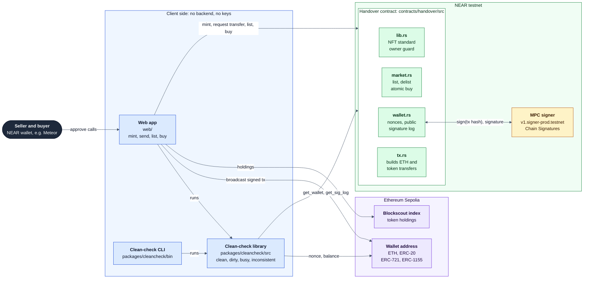

# Handover

**An NFT that owns its own Ethereum wallet, and a sale flow that lets you buy that wallet, with its ETH and tokens, without trusting the seller.** For anyone who needs to hand over a whole wallet instead of moving assets one by one: a project or treasury wallet passing to a new team, a funded wallet being sold, or a gift.

- **Live demo:** https://handover-blush.vercel.app (NEAR testnet and Ethereum Sepolia, no real funds)
- **Contract:** [`handover-v2-alpha.testnet`](https://testnet.nearblocks.io/address/handover-v2-alpha.testnet), **locked**: no access keys remain, so the code can never change ([`evidence/access-keys.txt`](evidence/access-keys.txt))
- **Proof:** a full sale of a wallet holding ETH, two ERC-20s, two NFTs and ERC-1155 items, every transaction listed in [`evidence/token-run-2026-11-05.md`](evidence/token-run-2026-11-05.md)
- **More:** folder map in [`structure.md`](structure.md); setup, deploy and security details in [`more-details.md`](more-details.md)

The demo video was recorded on the first deployment, `handover.handover-alpha.testnet` (the same design, ETH only, also locked); see [`more-details.md`](more-details.md#earlier-deployment).

## The problem

Some value cannot be moved by sending tokens: vesting and locks pay a fixed address, and a wallet with many assets takes many transactions to empty. Transferring it means transferring control of the address, which today means handing over a seed phrase. The seller keeps a copy, can drain the wallet after being paid, and the buyer can never prove otherwise.

NEAR Chain Signatures lets a contract control an Ethereum address that no one holds a key for, and an NFT can decide who may use it. But owning the NFT is not enough to make a sale safe. Four risks remain:

1. **Pre-signed transactions.** The seller gets a signature before selling, keeps it, sells, then broadcasts it.
2. **Standing approvals.** The seller approves another contract to spend the wallet's tokens. That right survives the sale.
3. **Upgradeable contract.** Whoever controls the contract account can upgrade it and take every wallet.
4. **Non-atomic payment.** The buyer pays and the seller does not transfer, or the reverse.

[NFT Chain Keys](https://github.com/near/multichain-gas-station-contract/tree/master/nft_key) already made MPC keys transferable as NFTs. **Handover adds what makes the wallet safely sellable**: public sequential signatures, signing frozen while listed, only self-built transfers (never an approval), a locked contract, and payment and transfer in one call.

## What it does

1. **Mint.** The seller mints a Handover NFT. It gets its own Ethereum address, derived from the contract account and `handover-<token_id>`.
2. **Fill.** Anyone sends ETH, ERC-20 tokens, NFTs or ERC-1155 items to that address from any wallet. No approval is needed to receive.
3. **Spend (owner only).** The owner sends ETH or any token. The contract builds the transaction itself (a plain ETH transfer, ERC-20 `transfer`, or ERC-721 / ERC-1155 `safeTransferFrom`), asks the MPC network to sign it, and appends it to a public log with the next nonce.
4. **List.** The owner sets a price. Signing freezes until the sale or a delist.
5. **Check.** Anyone runs the clean check: if the address's Sepolia nonce equals the number of signatures the contract ever issued, every signature has been used, so none is left to broadcast later. The buy panel lists what the sale includes (ETH and tokens).
6. **Buy.** The buyer pays exactly the price, bound to the nonce they checked. The NFT, the address and everything at it move to the buyer in one call; the seller is paid in the same call.
7. **Use.** From then on only the buyer can move anything. They can send one token, or use **Send everything** to empty the wallet to one address. The old owner's requests are refused: `Only the token owner can do this`.

**Invariant:** *once a Handover wallet shows clean, no one but the next owner can ever move its assets.*

## Built for NEAR HACKATHON

Tracks: **NFTs That Do Something** (`nfts`) and **Open Innovation** (`open`, chain abstraction). Security is a candidate third track, because resale safety is the core of the product.

| Track brief item | Where Handover does it | File |
|---|---|---|
| NFTs as accounts that own money | Each NFT controls a real Ethereum address and everything at it: ETH, ERC-20, ERC-721 and ERC-1155 | [`contracts/handover/src/wallet.rs`](contracts/handover/src/wallet.rs) |
| Hold inventory | The wallet page shows the address, its live balance, its tokens and its signature log | [`web/src/routes/wallet/+page.svelte`](web/src/routes/wallet/+page.svelte) |
| Carry access rights | Owning the NFT is the only way to get a signature for the address | [`contracts/handover/src/lib.rs`](contracts/handover/src/lib.rs) (`require_owner`) |
| Ownership with behaviour | Listing freezes signing; the contract refuses anything that could survive a sale | [`contracts/handover/src/market.rs`](contracts/handover/src/market.rs) |
| Chain abstraction | A NEAR contract controls an Ethereum account through Chain Signatures, with no private key anywhere | [`contracts/handover/src/mpc.rs`](contracts/handover/src/mpc.rs), [`tx.rs`](contracts/handover/src/tx.rs) |
| Security (candidate) | Public signature log, clean check, locked contract | [`packages/cleancheck/src/check.ts`](packages/cleancheck/src/check.ts) |

## Why NEAR is load-bearing

| NEAR feature | Role in the flow | File |
|---|---|---|
| **Chain Signatures** (MPC signer `v1.signer-prod.testnet`, `sign` with `payload_v2`, `domain_id` 0) | Signs every Ethereum transaction for the wallet's derived address | [`mpc.rs`](contracts/handover/src/mpc.rs), [`wallet.rs`](contracts/handover/src/wallet.rs) (`sign_promise`) |
| **NEP-171 / 177 / 178 / 181** via `near-contract-standards` 5.30.0 | The wallet is a standard NFT that wallets and explorers understand | [`lib.rs`](contracts/handover/src/lib.rs) |
| **Cross-contract call and callback** | Logs the signature, advances the nonce, keeps a failed attempt reserved | [`wallet.rs`](contracts/handover/src/wallet.rs) (`on_signed`) |
| **Deposits, promise transfers, 1-yocto confirmation** | Atomic `buy`; `list` and `delist` need a full-access key | [`market.rs`](contracts/handover/src/market.rs) |
| **Locked account** (keys deleted) | No upgrade or admin method exists, so the code is final | [`evidence/access-keys.txt`](evidence/access-keys.txt) |

Also used: NEP-297 events ([`events.rs`](contracts/handover/src/events.rs)), `env::keccak256` and `env::ecrecover` ([`tx.rs`](contracts/handover/src/tx.rs)). Without Chain Signatures the wallet would need a private key, which is exactly the problem Handover removes.

## What works now

Every claim with its code and proof: [`docs/CLAIMS.md`](docs/CLAIMS.md). The main ones:

| Claim | File | Proof |
|---|---|---|
| Only the owner gets signatures; the old owner is refused after a sale | [`lib.rs:231`](contracts/handover/src/lib.rs#L231) | test `old_owner_refused_after_buy`; live: [run](evidence/token-run-2026-11-05.md) step 9b |
| Only self-built transfers are signed: ETH, ERC-20 `transfer`, ERC-721 / ERC-1155 `safeTransferFrom`; never an approval | [`tx.rs:154`](contracts/handover/src/tx.rs#L154), [`tx.rs:252`](contracts/handover/src/tx.rs#L252) | test `only_plain_transfers_can_be_built`; tokens mined on Sepolia ([run](evidence/token-run-2026-11-05.md)) |
| Tokens move with the NFT: a buyer moved two ERC-20s, two NFTs and ERC-1155 items | [`wallet.rs:82`](contracts/handover/src/wallet.rs#L82) | [run](evidence/token-run-2026-11-05.md) steps 12 to 17 |
| Listing freezes signing; a failed MPC call never consumes a nonce | [`wallet.rs:228`](contracts/handover/src/wallet.rs#L228), [`wallet.rs:381`](contracts/handover/src/wallet.rs#L381) | tests `request_transfer_rejected_while_listed`, `failed_mpc_call_keeps_reservation_and_does_not_consume_nonce` |
| `buy` is atomic and bound to the checked nonce and exact price | [`market.rs:59`](contracts/handover/src/market.rs#L59) | test `buy_rejected_when_wallet_changed_after_check` |
| A pre-signed transaction is caught as `dirty` | [`check.ts`](packages/cleancheck/src/check.ts) | [demo run](evidence/demo-run-2026-11-05.md) (first deployment) |
| Deployed code = committed wasm; account locked | [`handover.wasm.sha256`](contracts/res/handover.wasm.sha256) | code hash `D2LpdVQX…ud8`; key deleted in NEAR tx `Aguy8dXR…nDA` |

## 30-second judge check

No wallet, no keys:

- Open https://handover-blush.vercel.app/wallet/?id=0. Your browser reads the contract and Sepolia and shows wallet #0 **Clean** (14 issued, Sepolia nonce 14), with a log naming each token transfer.
- Or from a terminal, after `pnpm install` in a clone (22 s measured):

  ```bash
  HANDOVER_CONTRACT=handover-v2-alpha.testnet pnpm --silent --filter @handover/cleancheck cli status 0
  ```

  ```text
    Contract                        handover-v2-alpha.testnet
    Address                         0xeaa892d7d280f5d92f552837fcb9a13518156c59
    Contract next_nonce (issued)    14
    Sepolia nonce (latest)          14
    VERDICT: CLEAN
      - Contract issued 14 signatures (nonces 0-13); Sepolia confirmed nonce is 14. Every signature has been used.
  ```

Full offline suite: `make verify` ([more-details.md](more-details.md#verify-everything-offline-make-verify)).

## Architecture



There is no backend: the browser and the CLI read NEAR and Sepolia directly, and only the NEAR contract can ask the MPC network for a signature, for transactions it built itself in `tx.rs`. Folder map with links to every folder README: [`structure.md`](structure.md).

## Measured results

| Item | Value | How to reproduce |
|---|---|---|
| Contract unit tests | 99 pass | `cargo test --manifest-path contracts/handover/Cargo.toml` |
| Clean-check tests | 136 pass (8 files) | `pnpm --filter @handover/cleancheck test` |
| Web chain-layer tests | 37 pass (4 files) | `pnpm --filter web test` |
| `handover.wasm` | 327837 bytes, SHA-256 `b2a43c5e99f532914a1c5005f9adaab8289d68a5de123383cf649e9feade00c7` (base58 `D2LpdVQXds9qea4B19ba835djiwimDxQWCUgNZXz4ud8`, the deployed code hash) | `make verify` step 4, [`contracts/res/BUILD.md`](contracts/res/BUILD.md) |
| Sepolia gas, token transfers signed by the contract | ERC-20 141,647; ERC-721 148,312; ERC-1155 135,309 (to a new holder) | receipts in [`token-run`](evidence/token-run-2026-11-05.md) steps 4, 7, 8 |
| Sepolia gas, ETH transfer | 21,000 to an existing address; about 24,400 to an EIP-7702 smart account; 204,600 to create a fresh address (Glamsterdam) | `eth_estimateGas`, receipt `0x7995249408ad663f87a161eaca1900ee3af41d454de39b874594e0b03d77ec46` |
| MPC sign round trip from a contract | 5.4 s, 12.9 Tgas burnt | [`evidence/sig-BmLN….json`](evidence/sig-BmLNbqK1tLowB6kpAg5cakJuhUkt3QP7nyMkVAHG85BY.json) |
| `request_transfer` with MPC and `on_signed` | 14.4 Tgas burnt (8 receipts), first deployment | NEAR tx `9JQoqVcLb8DUYz7dRT8XjayKW4ToJ5kT5rCzmyudGyRM` |
| `buy` | 5.0 Tgas burnt; seller received exactly the price, first deployment | NEAR tx `DLsK85AMxt9dhHv4GfhVbpEt7qF7agUCRnKffQcrAMQ2` |
| Fixed constants | sign fee 0.01 NEAR (+1 yocto to MPC), mint fee 0.05 NEAR, `release_stuck` after 300 blocks, ETH `gas_limit` 21000 to 300000, token `gas_limit` up to 500000 | [`lib.rs`](contracts/handover/src/lib.rs), [`tx.rs`](contracts/handover/src/tx.rs) |

Not measured yet: storage cost per logged signature on testnet.

## Built during the hackathon vs pre-existing

All project code was written during the hackathon window (first commit 2026-11-03), with AI coding assistance (Claude Code) under the builder's direction. Nothing is carried over from an earlier project. Libraries, with versions pinned in `Cargo.lock` / `pnpm-lock.yaml`:

| Area | Library | Version |
|---|---|---|
| Contract | `near-sdk` (feature `unstable`), `near-contract-standards` | 5.30.0, 5.30.0 |
| Contract | `omni-transaction` (feature `evm`), `hex` | 0.5.0, 0.4.3 |
| Contract tests | `k256`, `rlp` | 0.13.4, 0.6.1 |
| Build | `rustc`, `cargo-near` | 1.96.0, 0.22.0 |
| Clean check | `@noble/hashes`, `@noble/curves` | 2.4.0, 2.4.0 |
| Tooling | `typescript`, `tsx`, `vitest` | 6.0.3, 4.23.15, 5.1.0 |
| Checks | `chainsig.js`, `viem`, `@scure/base` | 1.1.16, 2.57.16, 2.4.0 |
| Web | `svelte`, `@sveltejs/kit`, `@sveltejs/adapter-static`, `vite` | 5.57.3, 3.1.1, 4.0.1, 8.3.5 |
| Web | `@hot-labs/near-connect`, `near-api-js`, `viem` | 0.12.0, 7.4.0, 2.57.16 |

The MPC signer and NFT Chain Keys are third-party and not copied here. Token holdings are read from Blockscout's public API (no key).

**Other project by the same builder** (rule Q-015): **Co-op**, https://github.com/AlphaTechini/co-op, hosted at https://coop.cyberpunkinc.xyz, contract `coop-alpha.testnet`.

## Run it

```bash
git clone https://github.com/AlphaTechini/handover && cd handover
make verify                    # offline: contract tests, clean-check tests, snapshots, wasm hash
cp web/.env.example web/.env   # web app settings (public values only)
make dev                       # web dev server
```

Prerequisites, the full `make verify` output, environment variables, the hosted demo walkthrough and the deploy runbook are in [`more-details.md`](more-details.md).

## Roadmap

- One approval for several transfers (needs a new contract account, since this one is locked).
- A clean-check rule that every logged transaction has one of the allowed shapes, and unit tests for the token encodings.
- Dynamic token metadata that shows the wallet's address, holdings and verdict.
- CLI: broadcast pending transactions, JSON output.

## Docs index

- [`more-details.md`](more-details.md): verify output, setup, deploy, how it works inside, security model and limits, the earlier deployment.
- [`structure.md`](structure.md): folder map with links to every folder README.
- [`docs/CLAIMS.md`](docs/CLAIMS.md): every claim mapped to code and proof.
- [`evidence/README.md`](evidence/README.md): live runs, transaction hashes, snapshots, key lists.
- [`contracts/handover/README.md`](contracts/handover/README.md): contract methods, guards and storage.
- [`docs/PRD.md`](docs/PRD.md) and [`docs/HACKATHON.md`](docs/HACKATHON.md): the original requirements and the hackathon brief.
